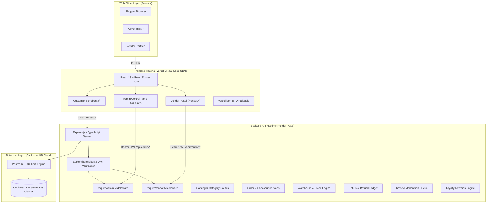
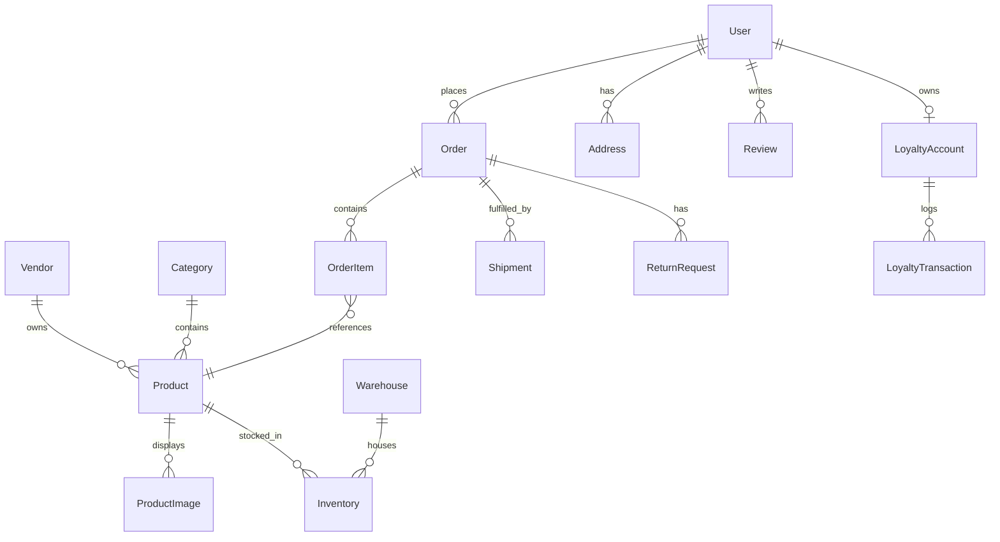

# GlobalCart — Complete System Architecture, Features & Operational Runbook

**Production URL**: [https://global-cart-three.vercel.app](https://global-cart-three.vercel.app)  
**API Backend**: [https://globalcart-api.onrender.com](https://globalcart-api.onrender.com)  
**Database**: CockroachDB Cloud (Distributed Serverless SQL)  
**Repository**: [https://github.com/Reneshb24/GlobalCart](https://github.com/Reneshb24/GlobalCart)  

---

## Table of Contents
1. [Executive Summary & Core Vision](#1-executive-summary--core-vision)
2. [Production Credentials for Team Mates](#2-production-credentials-for-team-mates)
3. [Full-Stack Architecture & Cloud Topology](#3-full-stack-architecture--cloud-topology)
4. [Technology Stack](#4-technology-stack)
5. [Database Architecture & Data Models (CockroachDB + Prisma)](#5-database-architecture--data-models)
6. [Core Program Logic & System Engines](#6-core-program-logic--system-engines)
7. [Comprehensive Features by Portal](#7-comprehensive-features-by-portal)
   - [Customer Storefront (`/`)](#customer-storefront-)
   - [Admin Control Panel (`/admin`)](#admin-control-panel-admin)
   - [Vendor Partner Portal (`/vendor`)](#vendor-partner-portal-vendor)
8. [Step-by-Step Operator Runbook](#8-step-by-step-operator-runbook)
9. [How to Manage & Extend the Platform](#9-how-to-manage--extend-the-platform)
   - [Adding New Vendors](#adding-new-vendors)
   - [Adding Warehouses & Rebalancing Inventory](#adding-warehouses--rebalancing-inventory)
   - [Managing Customer Accounts](#managing-customer-accounts)
   - [Adding Custom Products & Multi-Angle Photography](#adding-custom-products--multi-angle-photography)
10. [Local Development & Deployment Guide](#10-local-development--deployment-guide)

---

## 1. Executive Summary & Core Vision

**GlobalCart** is an enterprise-grade full-stack e-commerce management platform built as a single, cohesive web application that serves three distinct operational experiences:

1. **Customer Storefront (`/`)**: A consumer shopping interface featuring studio photography, real-time catalog search, price range filtering, multi-angle product galleries, persistent carts, wishlists, customer loyalty rewards, address book management, and post-purchase order tracking and return workflows.
2. **Admin Control Panel (`/admin`)**: A command center for platform managers to oversee global metrics, fulfill orders, dispatch carrier shipments, manage multi-warehouse stock deltas, toggle customer account statuses, resolve returns with ledger refunds, and moderate product reviews.
3. **Vendor Partner Portal (`/vendor`)**: A dedicated interface for verified third-party vendors to publish and manage catalog listings, monitor warehouse inventory for their SKUs, and view order fulfillment lines assigned to their business.

All three experiences share a consistent design language but maintain strict role isolation, independent workflows, and dedicated security guards.

---

## 2. Production Credentials for Team Mates

These pre-configured credentials allow immediate access to all platform roles on both the local environment and live production:

| Role | Portal URL | Email Address | Password | Capabilities |
| :--- | :--- | :--- | :--- | :--- |
| **Platform Administrator** | [`/admin`](https://global-cart-three.vercel.app/admin) | `globalcart.admin.dev@example.com` | `Admin123!` | Complete platform authority: catalog CRUD, warehouse inventory adjustment, order status advancing, shipment dispatch, customer account activation toggles, review moderation, return approvals, and refund issuance. |
| **Vendor Partner** | [`/vendor`](https://global-cart-three.vercel.app/vendor) | `demo-electronics@globalcart.example` | `Vendor123!` | Scoped seller portal: create and update vendor listings with live image preview, track warehouse inventory for vendor SKUs, and view customer order items assigned to this vendor. |
| **Customer Shopper** | [`/`](https://global-cart-three.vercel.app/) | Any email (or register a new account) | User defined | Browse products, 4-angle gallery view, cart & wishlist, address book, loyalty reward points, order history, live shipment tracking, and return requests. |

---

## 3. Full-Stack Architecture & Cloud Topology



### Network & Security Architecture
- **Origin Isolation**: The frontend is hosted on Vercel's global CDN; the API is hosted on Render in a dedicated container.
- **Cross-Origin Resource Sharing (CORS)**: Configured in `server.ts` to allow requests from the live Vercel domain, local development ports (`localhost:5173`), and preview URLs.
- **Fail-Closed RBAC**: Any request lacking a valid bearer token receives `401 Unauthorized`. Any token with mismatched role claims (`CUSTOMER` accessing `/api/admin/*` or `/api/vendor/*`) receives `403 Forbidden`.
- **Database Connection Security**: CockroachDB connections use TLS `sslmode=verify-full` with encrypted credentials.

---

## 4. Technology Stack

### Frontend Architecture
- **Core Framework**: React 19 (`react`, `react-dom`)
- **Build Tool & Bundler**: Vite 8 with Hot Module Replacement (HMR)
- **Language**: TypeScript 5 (Strict Mode enabled)
- **Routing**: React Router DOM 7 with client-side history navigation
- **Icons**: Lucide React (feather-style clean SVG icons)
- **HTTP Client**: Axios with automated bearer token interceptors
- **Styling**: Modern vanilla CSS3 with responsive CSS Grid, Flexbox, custom CSS variables, and fluid typography

### Backend Architecture
- **Runtime Environment**: Node.js 24 LTS
- **Web Framework**: Express 5 with modular sub-routers
- **Language**: TypeScript 7 compiled via `tsc`
- **Security & Hardening**:
  - `helmet`: Enforces HTTP security headers, Content Security Policy, and XSS protection.
  - `express-rate-limit`: Rate limits authentication attempts (max 10 login attempts per 15-minute window).
  - `bcryptjs`: Password hashing with 12 salt rounds.
  - `jsonwebtoken`: Stateless authentication using HMAC SHA-256 tokens.
- **Validation**: Zod schema validation for all incoming payloads.
- **ORM / Database Client**: Prisma 6.19.3 configured with native CockroachDB dialect.

---

## 5. Database Architecture & Data Models

GlobalCart uses **CockroachDB Cloud**, a distributed, PostgreSQL-wire-compatible relational database designed for zero-downtime scaling and ACID compliance.



### Primary Database Models

1. **`User`**:
   - `id`, `email`, `passwordHash`, `firstName`, `lastName`, `phone`, `role` (`CUSTOMER`, `ADMIN`, `VENDOR`, `SUPPORT`), `isActive`, timestamps.
2. **`Vendor`**:
   - `id`, `name`, `slug`, `email`, `description`, `isActive`, `createdAt`.
   - Links 1-to-1 with a `User` account via matching email.
3. **`Product`**:
   - `id`, `name`, `slug`, `description`, `priceInCents`, `currency`, `brand`, `sku`, `status` (`DRAFT`, `ACTIVE`, `ARCHIVED`), `categoryId`, `vendorId`.
4. **`ProductImage`**:
   - `id`, `productId`, `url`, `altText`, `position` (0 = hero, 1..3 = gallery angles).
5. **`Category`**:
   - `id`, `name`, `slug`, `description`, `parentId` (hierarchical taxonomy).
6. **`Warehouse` & `Inventory`**:
   - `Warehouse`: `id`, `name`, `code`, `city`, `country`.
   - `Inventory`: `id`, `productId`, `warehouseId`, `quantityOnHand`, `quantityReserved`. Available stock is computed dynamically as `(quantityOnHand - quantityReserved)`.
7. **`Order` & `OrderItem`**:
   - `Order`: `id`, `orderNumber`, `userId`, `status` (`PENDING`, `CONFIRMED`, `PROCESSING`, `SHIPPED`, `DELIVERED`, `CANCELLED`, `RETURNED`), `subtotalInCents`, `discountInCents`, `totalInCents`, `currency`, `shippingAddress`.
   - `OrderItem`: `id`, `orderId`, `productId`, `vendorId`, `quantity`, `unitPriceInCents`, `totalPriceInCents`.
8. **`Shipment`**:
   - `id`, `orderId`, `carrier`, `trackingNumber`, `status` (`PREPARING`, `DISPATCHED`, `IN_TRANSIT`, `OUT_FOR_DELIVERY`, `DELIVERED`), timestamps.
9. **`ReturnRequest`**:
   - `id`, `orderId`, `userId`, `reason`, `status` (`REQUESTED`, `APPROVED`, `RECEIVED`, `REFUNDED`, `REJECTED`, `CLOSED`), `refundAmountInCents`.
10. **`LoyaltyAccount` & `LoyaltyTransaction`**:
    - `LoyaltyAccount`: `id`, `userId`, `pointsBalance`, `tier` (`BRONZE`, `SILVER`, `GOLD`, `PLATINUM`).
    - `LoyaltyTransaction`: `id`, `accountId`, `pointsDelta`, `description`, `createdAt`.
11. **`Review`**:
    - `id`, `productId`, `userId`, `rating` (1–5), `title`, `comment`, `isApproved` (administrative moderation flag).

---

## 6. Core Program Logic & System Engines

### 1. Role-Based Access Control (RBAC) Engine
- Middleware [`authenticate.ts`](file:///c:/Projects/GlobalCart/backend/src/middleware/authenticate.ts) validates bearer tokens, decodes claims, verifies user active status in the database, and injects `req.user`.
- Middleware [`requireAdmin.ts`](file:///c:/Projects/GlobalCart/backend/src/middleware/requireAdmin.ts) verifies `req.user.role === 'ADMIN'`.
- Middleware [`requireVendor.ts`](file:///c:/Projects/GlobalCart/backend/src/middleware/requireVendor.ts) checks `req.user.role === 'VENDOR'`, queries the matching active `Vendor` record by email, and binds `req.vendor` with the verified `vendorId`.

### 2. Multi-Angle Product Image Resolution Pipeline
- Handled in [`productImages.ts`](file:///c:/Projects/GlobalCart/frontend/src/lib/productImages.ts) and [`ProductImg.tsx`](file:///c:/Projects/GlobalCart/frontend/src/ProductImg.tsx).
- When raw catalog items have placehold.co images, the deterministic resolver maps the SKU or name to 4 curated studio photography angles (Front, 45° Angle, In-Context Lifestyle, Detail Macro).
- Custom image URLs uploaded by Admins or Vendors take precedence.
- If network fails, images are blocked, or URLs 404, the `onError` hook automatically swaps the `src` to an inline SVG category graphic (`getCategoryPlaceholderSvg`) with category palettes (`#0284c7` for phones, `#7c3aed` for tech, `#d97706` for home).
- An internal ref prevents infinite fallback loops.

### 3. Inventory & Available Stock Computation
- In [`product.service.ts`](file:///c:/Projects/GlobalCart/backend/src/modules/catalog/product.service.ts), available stock is never stored as a static field; it is aggregated across all warehouse records:
  $$\text{Available Stock} = \sum (\text{quantityOnHand} - \text{quantityReserved})$$
- When an order is placed, reserved stock is incremented. When shipped, stock is decremented.

### 4. Order State Machine & Carrier Fulfillment
```
PENDING ───> CONFIRMED ───> PROCESSING ───> SHIPPED ───> DELIVERED
   │                                           │             │
   └───> CANCELLED                             └──> Tracking  └───> RETURN_REQUESTED
                                                    Updates           │
                                                                      ├──> APPROVED ──> REFUNDED
                                                                      └──> REJECTED
```
- Orders in `PENDING` status can be cancelled by the customer.
- Orders in `DELIVERED` status qualify for return requests.
- Admins dispatch shipments by selecting a carrier (`FedEx`, `UPS`, `DHL`, `BlueDart`) and tracking number, advancing tracking statuses with timeline records.

### 5. Return Resolution & Ledger Refund Engine
- Located in [`returns.routes.ts`](file:///c:/Projects/GlobalCart/backend/src/modules/returns.routes.ts).
- Customer submits return with reason.
- Admin reviews reason and inspects original order total.
- Approving triggers decision progression (`APPROVED` → `RECEIVED` → `REFUNDED`).
- Issuing refund logs an entry into the payment transaction ledger.

---

## 7. Comprehensive Features by Portal

### Customer Storefront (`/`)

| Feature Area | User Action | Technical Mechanism |
| :--- | :--- | :--- |
| **Catalog Browsing** | Search products by name, filter by category tabs | Query `GET /api/products?search=...&category=...` |
| **Price Range Slider** | Enter Min and Max price bounds | Debounced 350ms input state, updates query params |
| **Product Card Views** | Hover over product cards | 1:1 aspect ratio container, micro-zoom hover transition, stock indicator overlays |
| **Product Gallery** | Click **"Details"** on any product | Modal opens `ProductDetailsDialog.tsx` with 4-angle gallery and active border rings |
| **Review Writing** | Write reviews on product modal | Interactive star picker (1–5), title, feedback submitted to `POST /api/reviews` |
| **Shopping Cart** | Click bag icon to add, open cart drawer | Subtotal calculations, quantity +/- buttons with stock limit guards |
| **Wishlist** | Click heart icon on cards or details modal | Persisted in local state / user profile, displays count badge |
| **Address Book** | Manage shipping addresses in account modal | Standardizes addresses, normalizes ISO 3166-1 alpha-2 country codes |
| **Loyalty Program** | View points balance & transaction history | Tier badge (`BRONZE` to `PLATINUM`), points accrual on completed orders |
| **Order History & Tracking** | Click **"Orders"** button in header | Displays order list with product line-item thumbnails, live shipment tracking stepper |
| **Order Cancellation** | Cancel order while status is `PENDING` | Calls `POST /api/orders/:id/cancel` |
| **Return Requests** | Request return on delivered orders | Select return reason, creates `ReturnRequest` record |
| **Portal Switcher Hub** | Access Admin or Vendor portals | Top announcement bar, header pills, footer directory, and floating corner dock |

---

### Admin Control Panel (`/admin`)

| Feature Area | Admin Action | Operational Effect |
| :--- | :--- | :--- |
| **Operations Dashboard** | View live platform analytics | Metrics for Gross Sales, Total Orders, Units Sold, and Low Stock Alerts |
| **Order Management** | Search, filter, and inspect platform orders | View line items, payment methods, customer shipping info, and return state |
| **Shipment Dispatch** | Create carrier shipments for confirmed orders | Select carrier, enter tracking code; updates order to `SHIPPED` |
| **Shipment Progression**| Advance tracking status | Stepper controls (`PREPARING` → `DISPATCHED` → `IN_TRANSIT` → `DELIVERED`) |
| **Catalog Management** | Create and edit products | Set SKU, title, category, price, brand, description, and primary Image URL with live preview |
| **Category Creation** | Add catalog categories | Set name, slug, description, and parent category |
| **Warehouse Control** | Add warehouses and adjust stock | Enter warehouse code, city; adjust stock deltas (+/-) per SKU |
| **Customer Registry** | View registered users | Inspect customer total spend, total orders; toggle account active/inactive switch |
| **Review Moderation** | Review customer reviews | Pending queue table; one-click **Approve** (makes visible) or **Reject** |
| **Returns & Refunds** | Process customer return requests | Review return reason; click **Approve**, mark **Received**, and issue **Refund** |
| **Financial Ledger** | Audit platform payments | View simulated card, COD, and refund ledger entries |
| **Store Return Link** | Jump back to customer storefront | Top bar **"← Return to Store"** button |

---

### Vendor Partner Portal (`/vendor`)

| Feature Area | Vendor Action | Operational Effect |
| :--- | :--- | :--- |
| **Partner Dashboard** | View vendor business summary | Vendor-scoped revenue, units sold, active listings count, and low-stock count |
| **Listing Management** | Create and update vendor products | Auto-scoped to vendor ID; provides Image URL field with live visual preview card |
| **Inventory Oversight** | Monitor warehouse stock levels | View quantity on hand and reserved stock across all platform warehouses |
| **Customer Orders** | View orders containing vendor SKUs | Scoped order items table with product thumbnails and fulfillment status |
| **Partner Guard** | Access restricted screen | Redirects unauthorized users; provides **"← Back to Store"** return link |

---

## 8. Step-by-Step Operator Runbook

### Scenario A: How to Place an Order as a Customer
1. Visit [https://global-cart-three.vercel.app](https://global-cart-three.vercel.app).
2. Browse products, click **"Details"** on any item to view all 4 gallery angles.
3. Click **"Add to Cart"** or use the shopping bag icon on the card.
4. Open the Cart drawer (top right), adjust quantities if needed, and proceed to checkout.
5. Select a shipping address from your Address Book (or add a new address).
6. Choose payment method (`Cash on Delivery` or `Simulated Card`) and confirm order.
7. Click **"Orders"** in the header to view your order, line-item thumbnails, and status.

### Scenario B: How to Fulfill an Order as an Administrator
1. Navigate to `/admin` or click **"Admin"** in the top portal switcher.
2. Log in with `globalcart.admin.dev@example.com` / `Admin123!`.
3. Click **"Orders"** in the left navigation sidebar.
4. Click **"View Details"** on any `PENDING` or `CONFIRMED` order.
5. In the shipment section, select a carrier (e.g., `FedEx`) and enter a tracking number.
6. Click **"Create Shipment"**. The order status updates to `SHIPPED`.
7. As the package moves, click **"Advance Status"** to update customer tracking in real time.

### Scenario C: How to Add a New Product with Images
1. In the Admin Panel, click **"Catalog"** → **"New Product"** (or in the Vendor Portal, click **"New Listing"**).
2. Enter:
   - **Name**: e.g., `Studio Noise-Cancelling Headphones Pro`
   - **SKU**: e.g., `GC-AUDIO-NC-002`
   - **Category**: Select appropriate category
   - **Price**: e.g., `129.99`
   - **Image URL**: Enter any public HTTPS image link (e.g., from Unsplash). The live preview card will display the image immediately.
3. Click **"Create Product"**.
4. The product appears instantly in the catalog table with its thumbnail and becomes available on the storefront.

### Scenario D: How to Moderate Product Reviews
1. In the Admin Panel, click **"Reviews"**.
2. Any newly submitted review appears in the **Pending Moderation** table.
3. Inspect the rating, title, and comments.
4. Click **"Approve"** to publish the review to the public product modal, or **"Reject"** to hide it.

### Scenario E: How to Process a Customer Return & Issue a Refund
1. When a customer requests a return on a delivered order, navigate to Admin Panel → **"Returns"**.
2. Inspect the customer's stated reason (e.g., "Item defective" or "Wrong size").
3. Click **"Approve Return"**.
4. Once the returned item arrives at the warehouse, click **"Mark Received"**.
5. Click **"Issue Refund"**. The refund amount is automatically recorded in the payment ledger.

---

## 9. How to Manage & Extend the Platform

### Adding New Vendors
Vendors in GlobalCart are linked to a user account with the `VENDOR` role:
1. In CockroachDB (or via backend script), create a new `User` record with `role: 'VENDOR'`.
2. Insert a matching record into the `Vendor` table with the same `email`:
   ```sql
   INSERT INTO "Vendor" (id, name, slug, email, "isActive", "createdAt")
   VALUES (gen_random_uuid(), 'Artisan Home Goods', 'artisan-home-goods', 'artisan@globalcart.example', true, NOW());
   ```
3. The seller can now log into `/vendor` and manage listings isolated exclusively to their vendor account.

### Adding Warehouses & Rebalancing Inventory
1. In the Admin Panel, click **"Inventory"** → **"Add Warehouse"**.
2. Enter:
   - **Warehouse Name**: e.g., `West Coast Distribution Center`
   - **Code**: e.g., `WH-US-WEST-01`
   - **City**: e.g., `Reno`
3. Click **"Save Warehouse"**.
4. To allocate inventory, click **"Adjust Stock"** on any product row, select the warehouse, and enter the quantity delta (e.g., `+50`).

### Managing Customer Accounts
1. In the Admin Panel, click **"Customers"**.
2. View user registration dates, order counts, and lifetime spend.
3. If an account requires suspension due to policy violations, click **"Deactivate"**.
4. Deactivated accounts are instantly blocked by `authenticateToken` middleware from logging in or checking out.

---

## 10. Local Development & Deployment Guide

### Running Locally

```bash
# 1. Clone repository
git clone https://github.com/Reneshb24/GlobalCart.git
cd GlobalCart

# 2. Run Backend (Port 4000)
cd backend
npm install
npm run build
npm start
# API running at http://localhost:4000

# 3. Run Frontend (Port 5173) in a new terminal
cd ../frontend
npm install
npm run dev
# App running at http://localhost:5173
```

### Production Deployment Setup

#### Backend (Render.com)
- **Repository**: `Reneshb24/GlobalCart`
- **Root Directory**: `backend`
- **Build Command**: `npm install --include=dev && npm run build`
- **Start Command**: `npm start`
- **Health Check Path**: `/api/health`
- **Environment Variables**:
  - `DATABASE_URL`: `postgresql://<user>:<password>@<cluster-host>:26257/defaultdb?sslmode=verify-full`
  - `JWT_SECRET`: 64-character high-entropy secret string
  - `NODE_ENV`: `production`
  - `CORS_ORIGINS`: `https://global-cart-three.vercel.app`

#### Frontend (Vercel)
- **Repository**: `Reneshb24/GlobalCart`
- **Root Directory**: `frontend`
- **Framework Preset**: `Vite`
- **Build Command**: `npm run build`
- **Output Directory**: `dist`
- **Environment Variables**:
  - `VITE_API_URL`: `https://globalcart-api.onrender.com/api`

---

*Document compiled and verified for GlobalCart Production Release 1.0.0.*
