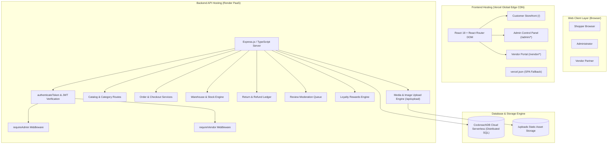
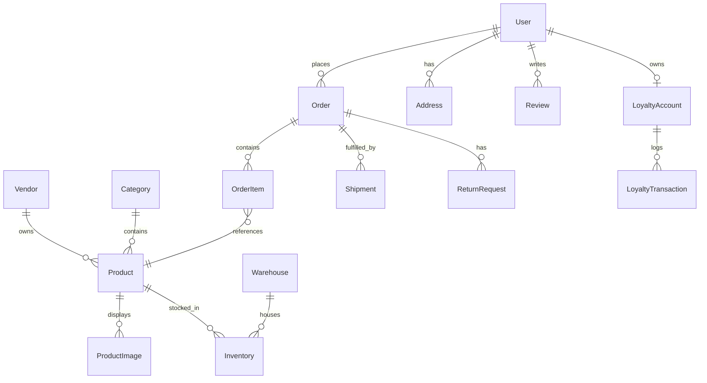

# GlobalCart — Complete System Architecture, Features & Operational Runbook

**Production URL**: [https://global-cart-three.vercel.app](https://global-cart-three.vercel.app)  
**API Backend**: [https://globalcart-api.onrender.com](https://globalcart-api.onrender.com)  
**Database**: CockroachDB Cloud (Distributed Serverless SQL)  
**Repository**: [https://github.com/Reneshb24/GlobalCart](https://github.com/Reneshb24/GlobalCart)  

---

## Table of Contents
1. [Executive Summary & Core Vision](#1-executive-summary--core-vision)
2. [Production Credentials for Team Mates](#2-production-credentials-for-team-mates)
3. [Full-Stack Architecture & Cloud Topology](#3-full-stack-architecture--cloud-topology)
4. [Technology Stack](#4-technology-stack)
5. [Database Architecture & Data Models (CockroachDB + Prisma)](#5-database-architecture--data-models)
6. [Core Program Logic & System Engines](#6-core-program-logic--system-engines)
7. [Comprehensive Features by Portal](#7-comprehensive-features-by-portal)
   - [Customer Storefront & Account Portal (`/`)](#customer-storefront--account-portal-)
   - [Admin Control Panel (`/admin`)](#admin-control-panel-admin)
   - [Vendor Partner & Seller Hub (`/vendor`)](#vendor-partner--seller-hub-vendor)
   - [Warehouse & Multi-Hub Fulfillment Operations](#warehouse--multi-hub-fulfillment-operations)
8. [Step-by-Step Operator Runbook](#8-step-by-step-operator-runbook)
9. [How to Manage & Extend the Platform](#9-how-to-manage--extend-the-platform)
   - [Self-Service Vendor Onboarding & Nearest Warehouse Hub](#self-service-vendor-onboarding--nearest-warehouse-hub)
   - [Multi-Angle Studio Photography & Local File Uploads](#multi-angle-studio-photography--local-file-uploads)
   - [Catalog Deletion & Safe Historical Archiving](#catalog-deletion--safe-historical-archiving)
   - [Managing Customer Accounts](#managing-customer-accounts)
10. [Local Development & Deployment Guide](#10-local-development--deployment-guide)

---

## 1. Executive Summary & Core Vision

**GlobalCart** is an enterprise-grade full-stack multi-vendor e-commerce marketplace and cluster operations platform inspired by Amazon and Flipkart. Built as a single, cohesive web application, it orchestrates four interconnected operational experiences:

1. **Customer Storefront & Account Portal (`/`)**: A consumer shopping interface featuring studio photography, real-time catalog search, price range filtering, multi-angle product galleries, 1-Click "⚡ Buy Now" direct checkout, persistent carts, wishlists, SuperCoins loyalty rewards, address book management, real-time 5-stage shipment tracking stepper, and post-purchase return workflows.
2. **Admin Command Center (`/admin`)**: A command center for platform managers to oversee global metrics, fulfill orders, dispatch carrier shipments, advance 5-milestone tracking stages, manage multi-warehouse stock allocations, adjust stock deltas, delete/archive out-of-stock listings, toggle customer account statuses, resolve returns with ledger refunds, and moderate product reviews.
3. **Vendor Partner & Seller Hub (`/vendor`)**: A dedicated interface for verified merchants and new sellers featuring self-service business onboarding with nearest fulfillment warehouse selection, publish catalog listings with 4 camera angle image inputs (URLs or direct device file uploads), monitor warehouse inventory for their SKUs, delete out-of-stock listings, and manage order fulfillment lines assigned to their business.
4. **Warehouse & Multi-Hub Fulfillment Operations**: Distributed inventory control across regional hubs (US East, EU Central, APAC South). Dynamic stock aggregation ($\text{Available} = \sum (\text{OnHand} - \text{Reserved})$), atomic checkout reservation, and carrier dispatch tracking.

All four experiences share a unified backend, persistent CockroachDB storage, and strict role isolation.

---

## 2. Production Credentials for Team Mates

These pre-configured credentials allow immediate access to all platform roles on both the local environment and live production:

| Role | Portal URL | Email Address | Password | Capabilities |
| :--- | :--- | :--- | :--- | :--- |
| **Platform Administrator** | [`/admin`](https://global-cart-three.vercel.app/admin) | `globalcart.admin.dev@example.com` | `Admin123!` | Complete platform authority: catalog CRUD, warehouse inventory adjustment, order status advancing, shipment dispatch, customer account activation toggles, review moderation, return approvals, and refund issuance. |
| **Vendor Partner** | [`/vendor`](https://global-cart-three.vercel.app/vendor) | `demo-electronics@globalcart.example` | `Vendor123!` | Scoped seller portal: self-service registration, 4 camera angle listing creation with file upload, multi-warehouse stock monitoring, out-of-stock listing deletion, and order line tracking. |
| **Customer Shopper** | [`/`](https://global-cart-three.vercel.app/) | Any email (or register a new account) | User defined | Browse products, 4-angle gallery view, 1-Click Buy Now, coupons, SuperCoins loyalty points, order history, live 5-stage shipment tracking, and return requests. |

---

## 3. Full-Stack Architecture & Cloud Topology



---

## 4. Technology Stack

### Frontend
- **Framework**: React 19 (`react`, `react-dom`)
- **Build Tool**: Vite 8 (Hot Module Replacement, fast bundling)
- **Language**: TypeScript 5
- **Routing**: React Router DOM 7 (Client-side routing with SPA rewrite rules)
- **Styling**: Vanilla CSS3 (Custom design system, CSS Grid, Flexbox, responsive breakpoints)
- **Icons**: Lucide React
- **HTTP Client**: Axios (Automated bearer token interceptors)
- **Hosting**: Vercel (Global Edge CDN, automatic HTTPS, immutable asset caching)

### Backend API
- **Runtime**: Node.js v20.x
- **Framework**: Express.js
- **Language**: TypeScript
- **Database Client**: Prisma ORM (Strongly-typed data access, migration engine)
- **Validation**: Zod (Strict schema parsing for query params and request bodies)
- **Authentication**: JWT (`jsonwebtoken`) + `bcryptjs` password hashing
- **Security**: Helmet HTTP headers (with cross-origin resource policy), CORS whitelisting, Express Rate Limit
- **Media Uploads**: Base64 data URI parsing, MIME verification, 10MB payload capacity, static hosting
- **Hosting**: Render PaaS (Managed containerized service)

### Database Layer
- **Engine**: CockroachDB Cloud
- **Architecture**: Distributed SQL, Multi-Region Active-Active Replication
- **Consistency**: Serialisable ACID Transactions

---

## 5. Database Architecture & Data Models



### Primary Database Models

1. **`User`**:
   - `id`, `email`, `passwordHash`, `firstName`, `lastName`, `phone`, `role` (`CUSTOMER`, `ADMIN`, `VENDOR`, `SUPPORT`), `isActive`, timestamps.
2. **`Vendor`**:
   - `id`, `name`, `email`, `phone`, `isActive`, `createdAt`, `updatedAt`.
   - Linked to a `User` account via matching business email.
3. **`Product`**:
   - `id`, `name`, `slug`, `description`, `price`, `currency`, `brand`, `sku`, `status` (`DRAFT`, `ACTIVE`, `ARCHIVED`), `categoryId`, `vendorId`.
4. **`ProductImage`**:
   - `id`, `productId`, `url`, `altText`, `position` (0 = hero front, 1 = side profile, 2 = lifestyle, 3 = macro detail).
5. **`Category`**:
   - `id`, `name`, `slug`, `description`, `parentId` (hierarchical taxonomy).
6. **`Warehouse` & `Inventory`**:
   - `Warehouse`: `id`, `name`, `code`, `city`, `region`, `countryCode`, `isActive`.
   - `Inventory`: `id`, `productId`, `warehouseId`, `quantityOnHand`, `quantityReserved`. Available stock is computed dynamically as `(quantityOnHand - quantityReserved)`.
7. **`Order` & `OrderItem`**:
   - `Order`: `id`, `orderNumber`, `userId`, `status` (`PENDING`, `CONFIRMED`, `PROCESSING`, `SHIPPED`, `DELIVERED`, `CANCELLED`, `RETURNED`), `subtotal`, `discount`, `total`, `currency`, `shippingAddress`.
   - `OrderItem`: `id`, `orderId`, `productId`, `vendorId`, `quantity`, `unitPrice`, `totalPrice`.
8. **`Shipment`**:
   - `id`, `orderId`, `carrier`, `trackingNumber`, `status` (`PREPARING`, `DISPATCHED`, `IN_TRANSIT`, `OUT_FOR_DELIVERY`, `DELIVERED`), `shippedAt`, `deliveredAt`.
9. **`ReturnRequest`**:
   - `id`, `orderId`, `userId`, `reason`, `status` (`REQUESTED`, `APPROVED`, `RECEIVED`, `REFUNDED`, `REJECTED`, `CLOSED`), `refundAmount`.
10. **`LoyaltyAccount` & `LoyaltyTransaction`**:
    - `LoyaltyAccount`: `id`, `userId`, `pointsBalance`, `tier` (`BRONZE`, `SILVER`, `GOLD`, `PLATINUM`).
    - `LoyaltyTransaction`: `id`, `accountId`, `points`, `description`, `createdAt`.
11. **`Review`**:
    - `id`, `productId`, `userId`, `rating` (1–5), `title`, `comment`, `isApproved` (administrative moderation flag).

---

## 6. Core Program Logic & System Engines

### 1. Role-Based Access Control (RBAC) Engine
- Middleware `authenticate.ts` validates bearer tokens, decodes claims, verifies user active status in the database, and injects `req.auth`.
- Middleware `requireAdmin.ts` verifies `req.auth.role === 'ADMIN'`.
- Middleware `requireVendor.ts` checks `req.auth.role === 'VENDOR'`, queries the matching active `Vendor` record by email, and binds `req.vendor` with the verified vendor identity.

### 2. Multi-Perspective Imagery & Device Upload Pipeline
- Handled in `upload.routes.ts`, `productImages.ts`, and `ProductImg.tsx`.
- Supports 4 photographic angles per listing.
- Users can paste URLs OR click **Upload** to select image files from their local device.
- Uploads are decoded from base64, checked against MIME rules, stored in `uploads/`, and served statically.

### 3. Inventory & Available Stock Computation
- In `product.service.ts`, available stock is never stored as a static field; it is aggregated across all warehouse records:
  $$\text{Available Stock} = \sum (\text{quantityOnHand} - \text{quantityReserved})$$
- When an order is placed, reserved stock is incremented. When shipped, stock is decremented.

### 4. 5-Stage Live Order Fulfillment Stepper
```
PREPARING ───> DISPATCHED ───> IN_TRANSIT ───> OUT_FOR_DELIVERY ───> DELIVERED
   │                                                                     │
   └───> Cancelled                                                       └───> Return Requested
```
- Interactive progression in the Admin Panel (`handleProgressShipment`) advances milestones.
- Customer-facing visual delivery tracker renders active stage highlights, checkmarks, carrier info, and tracking code.

### 5. SuperCoins & Coupon Discount Engine
- Fixed or percentage coupon codes (`SAVE10`, `TECH20`, `WELCOME50`) are validated against order subtotals.
- SuperCoins are earned on delivered purchases and can be redeemed at checkout ($100 \text{ pts} = \$1.00$).

---

## 7. Comprehensive Features by Portal

### Customer Storefront & Account Portal (`/`)

| Feature Area | User Action | Technical Mechanism |
| :--- | :--- | :--- |
| **Catalog Browsing** | Search products by name, filter by category tabs | Query `GET /api/products?search=...&category=...` |
| **Price Range Slider** | Enter Min and Max price bounds | Debounced 350ms input state, updates query params |
| **1-Click Buy Now** | Click "⚡ Buy Now" button on details modal | Bypasses cart, directly triggers fast checkout modal with selected quantity |
| **Product Gallery** | Click **"Details"** on any product | Modal opens `ProductDetailsDialog.tsx` with 4-angle gallery and active border rings |
| **SuperCoins Redemption**| Check "Redeem SuperCoins" during checkout | Deducts points balance for instant discount ($100 \text{ pts} = \$1.00$) |
| **Coupon Code Input** | Enter `SAVE10`, `TECH20`, `WELCOME50` | Validates coupon rules and discounts order subtotal |
| **Shopping Cart & Wishlist**| Add/remove items, toggle heart icon | Persisted in local state / user profile, displays count badge |
| **5-Stage Live Tracking**| Open Orders tab → Click "Follow Delivery" | Interactive 5-step visual delivery tracker (`PREPARING` to `DELIVERED`) |
| **Return Requests** | Request return on delivered orders | Select return reason, creates `ReturnRequest` record |

---

### Admin Control Panel (`/admin`)

| Feature Area | Admin Action | Operational Effect |
| :--- | :--- | :--- |
| **Operations Dashboard** | View live platform analytics | Metrics for Gross Sales, Total Orders, Units Sold, and Low Stock Alerts |
| **Order Management** | Search, filter, and inspect platform orders | View line items, payment methods, customer shipping info, and return state |
| **Shipment Dispatch** | Create carrier shipments for confirmed orders | Select carrier (`FedEx`, `UPS`, `DHL`, `BlueDart`), enter tracking code |
| **Shipment Progression**| Advance tracking milestones | Stepper controls (`PREPARING` → `DISPATCHED` → `IN_TRANSIT` → `OUT_FOR_DELIVERY` → `DELIVERED`) |
| **Catalog Management** | Create and edit products with 4 angles | URL inputs + local device file upload pickers with instant preview |
| **Product Deletion** | Delete or archive out-of-stock listings | Clean deletion if zero orders; safe archival (`ARCHIVED`) if historical orders exist |
| **Warehouse Control** | Add warehouses and adjust stock | Enter warehouse code, city; adjust stock deltas (+/-) per SKU |
| **Customer Registry** | View registered users | Inspect customer total spend, total orders; toggle account active/inactive switch |
| **Review Moderation** | Review customer reviews | Pending queue table; one-click **Approve** (makes visible) or **Reject** |
| **Returns & Refunds** | Process customer return requests | Review return reason; click **Approve**, mark **Received**, and issue **Refund** |

---

### Vendor Partner & Seller Hub (`/vendor`)

| Feature Area | Vendor Action | Operational Effect |
| :--- | :--- | :--- |
| **Self-Service Onboarding**| Register as a new seller | Provide business name, credentials, and select nearest fulfillment warehouse |
| **Partner Dashboard** | View vendor business summary | Vendor-scoped revenue, units sold, active listings count, and low-stock count |
| **Listing Management** | Create and update vendor products | 4 photographic camera angles with direct file upload and URL inputs |
| **Listing Deletion** | Delete or archive vendor products | Removes listing from catalog if zero orders, or archives if orders exist |
| **Inventory Oversight** | Monitor warehouse stock levels | View quantity on hand and reserved stock across all platform warehouses |
| **Customer Orders** | View orders containing vendor SKUs | Scoped order items table with product thumbnails and fulfillment status |

---

### Warehouse & Multi-Hub Fulfillment Operations

| Feature Area | Operational Capability | Impact |
| :--- | :--- | :--- |
| **Multi-Hub Routing** | Regional fulfillment hubs (US East, EU Central, APAC South) | Reduces transit time and shipping costs |
| **Dynamic Stock Balancing** | Rebalance stock via positive/negative deltas | Inventory is allocated per warehouse without database lock contention |
| **Atomic Reservations** | Stock reserved at checkout, decremented at shipment | Eliminates overselling under concurrent load |

---

## 8. Step-by-Step Operator Runbook

### Scenario A: Customer 1-Click Buy Now & SuperCoins Redemption
1. Visit [https://global-cart-three.vercel.app](https://global-cart-three.vercel.app).
2. Click any product to inspect the 4-perspective photographic studio gallery.
3. Select quantity (e.g., 2) and click the amber **"⚡ Buy Now"** button.
4. In the checkout modal, enter coupon code `SAVE10` or check **"Redeem SuperCoins"**.
5. Select or enter a shipping address and confirm order.
6. The order is placed and confirmation displays earned SuperCoins and redeemed discounts.

### Scenario B: Admin Shipment Dispatch & 5-Stage Live Progression
1. Log into the Admin Panel at `/admin` (`globalcart.admin.dev@example.com` / `Admin123!`).
2. Go to **"Orders"**, select the new order, and click **"Dispatch Shipment"**.
3. Choose carrier (`FedEx`, `UPS`, `DHL`, `BlueDart`) and enter tracking code.
4. Advance the shipment stage by stage: `Mark Dispatched` → `In Transit` → `Out for Delivery` → `Confirm Delivered`.
5. The customer's order tracking stepper updates simultaneously to show delivery completion.

### Scenario C: Vendor Registration with Nearest Warehouse Hub & Image Uploads
1. Navigate to `/vendor` and click **"Register New Seller"**.
2. Enter your business name, contact person, business email, password, and select your nearest regional fulfillment warehouse.
3. Submit registration to immediately enter the Vendor Dashboard.
4. Click **"Add New Product"**, enter details, set initial stock and warehouse.
5. In the 4 angle cards, click **Upload** to choose photo files from your computer (or paste URLs).
6. Click **"Create Listing"** to launch the product in the storefront catalog.

### Scenario D: Deleting or Archiving Out-of-Stock Listings
1. In either Admin Panel (`/admin`) or Vendor Portal (`/vendor`), locate any product table row.
2. If stock is 0, an **"Out of Stock"** indicator displays.
3. Click the red trash icon or open the edit modal and click **"Delete Product"**.
4. If the product has never been ordered, it is permanently deleted; if historical orders exist, it is safely transitioned to `ARCHIVED`.

---

## 9. How to Manage & Extend the Platform

### Self-Service Vendor Onboarding & Nearest Warehouse Hub
New vendors can self-register via `POST /api/auth/register-vendor` directly from the web interface. The nearest warehouse selection connects their seller account to regional fulfillment logistics.

### Multi-Angle Studio Photography & Local File Uploads
Image uploads are processed via `POST /api/upload`, stored in `uploads/`, and served statically with cross-origin headers, allowing high-resolution imagery across devices.

### Catalog Deletion & Safe Historical Archiving
The deletion pipeline (`DELETE /api/admin/products/:id` and `DELETE /api/vendor/products/:id`) prevents orphaned records while allowing clean catalog pruning.

### Managing Customer Accounts
Administrators can deactivate accounts in `/admin/customers`, preventing suspended users from authenticating or checking out.

---

## 10. Local Development & Deployment Guide

```bash
# 1. Clone repository
git clone https://github.com/Reneshb24/GlobalCart.git
cd GlobalCart

# 2. Run Backend (Port 4000)
cd backend
npm install
npm run build
npm start

# 3. Run Frontend (Port 5173) in a new terminal
cd ../frontend
npm install
npm run dev
```

*Document compiled and verified for GlobalCart Production Release 1.0.0.*
